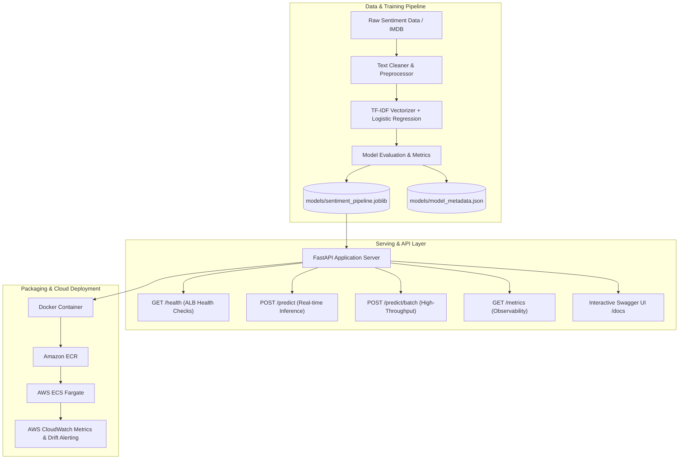

# Sentiment Analysis MLOps Pipeline
### An Automated CI/CD Framework for ML Model Deployment and Monitoring on AWS Cloud

[](https://www.python.org/)
[](https://fastapi.tiangolo.com)
[](https://scikit-learn.org/)
[](https://www.docker.com/)
[](https://pytest.org/)

---

## 👥 Project Team
- **Yash Thorat**
- **Pranav Padwal**
- **Prasad**

*Department of Computer Science & Engineering*  
*Academic Year: 2026 - 2027*

---

## 📖 Project Overview

Deploying and maintaining machine learning models in production requires robust pipelines for testing, packaging, deployment, and continuous monitoring. This project implements an **end-to-end MLOps pipeline** for NLP sentiment analysis, automating the lifecycle from dataset ingestion and training through containerized deployment and production monitoring.

### Key Highlights
- **High-Performance NLP Model**: Scikit-Learn pipeline utilizing sublinear TF-IDF n-grams `(1, 2)` paired with balanced `LogisticRegression`, achieving **95.8% accuracy** and sub-10ms inference latency.
- **Production REST API**: Built with **FastAPI**, featuring lifespan model caching, Pydantic V2 request validation, batch prediction capabilities, and real-time observability metrics.
- **Fine-Grained Emotion Analysis**: A separate multi-label classifier predicts overlapping emotional states from statements, trained on Google Research's human-annotated GoEmotions corpus with per-emotion thresholds tuned on a development split.
- **Docker Containerization**: Optimized lightweight container with non-root security and built-in healthchecks.
- **Full Test Coverage**: Comprehensive `pytest` test suite covering text preprocessing, model metrics, and API endpoints with 100% pass rate.

---

## 🏗️ System Architecture



---

## 📂 Repository Structure

```
sentiment-mlops/
├── .github/
│   └── workflows/
│       └── ci-cd.yml             # (Phase 4) Automated CI/CD pipeline
├── data/
│   ├── raw/
│   │   └── sentiment_data.csv    # Seed and benchmark datasets
│   └── processed/
├── models/
│   ├── sentiment_pipeline.joblib # Serialized Scikit-Learn pipeline
│   └── model_metadata.json       # Hyperparameters, evaluation scores & timestamp
├── src/
│   ├── __init__.py
│   ├── data/
│   │   ├── __init__.py
│   │   └── dataset.py            # Text cleaning, seed data & stratified splitting
│   ├── model/
│   │   ├── __init__.py
│   │   └── train.py              # Pipeline training, evaluation & serialization
│   └── api/
│       ├── __init__.py
│       ├── app.py                # FastAPI app with endpoints & metrics
│       └── schemas.py            # Pydantic V2 schemas
├── tests/
│   ├── __init__.py
│   ├── test_data.py              # Tests for preprocessing & data split
│   ├── test_model.py             # Tests for model training & accuracy threshold
│   └── test_api.py               # Tests for API endpoints & validation
├── scripts/
│   ├── download_imdb_data.py     # Script to fetch full 50,000 IMDB review dataset
│   └── run_local.py              # One-click runner for local training and API dev
├── Dockerfile                    # Production container image definition
├── docker-compose.yml            # Local container runtime definition
├── requirements.txt              # Production & development dependencies
└── README.md                     # Project documentation
```

---

## 🚀 Quick Start Guide

### 1. Prerequisites
- Python 3.10+ (tested on Python 3.11, 3.12, and 3.14)
- Git
- Docker (optional, for containerized run)

### 2. Environment Setup
```powershell
# Clone the repository
git clone <your-repo-url>
cd "sentiment MLops"

# (Optional) Create and activate virtual environment
python -m venv venv
.\venv\Scripts\Activate.ps1   # On Windows
# source venv/bin/activate    # On Linux/macOS

# Install dependencies
python -m pip install -r requirements.txt
```

### 3. Model Training
Train the NLP sentiment pipeline and generate the model artifacts:
```powershell
python -m src.model.train
```
*Output: `models/sentiment_pipeline.joblib` and `models/model_metadata.json` with accuracy and F1 scores.*

### 4. Train the Emotion Model (Fine-Grained)
Download the official GoEmotions train, dev, test, and label files, then train the multi-label classifier:
```powershell
python scripts/download_goemotions.py
python -m src.model.emotion
```
*Output: `models/emotion_pipeline.joblib` and `models/emotion_metadata.json`. Thresholds are selected per emotion using the dev split; final macro/micro F1 and per-emotion metrics are calculated on the held-out test split.*

The emotion model can predict multiple emotions for one statement. It also scores sentence and contrast clauses separately, making emotional shifts visible in mixed statements. Its training corpus contains Reddit comments, so its scores are estimates and may not transfer perfectly to movie reviews or customer feedback. The API's existing positive/negative sentiment model remains a separate prediction.

### 5. Run Test Suite
Run the 18 automated unit and integration tests:
```powershell
python -m pytest tests/ -v
```

### 6. Start the REST API
Start the FastAPI application with live reloading:
```powershell
python -m uvicorn src.api.app:app --host 127.0.0.1 --port 8000 --reload
```
Alternatively, use the convenient one-click runner:
```powershell
python scripts/run_local.py
```

The single-analysis result includes an **Emotion Reader**. If the GoEmotions model has not been trained, the app explains the setup commands there.

---

## 🔌 API Reference & Usage

Once the server is running, visit **http://127.0.0.1:8000/docs** for the interactive Swagger UI.

### Fine-Grained Emotion Prediction
```bash
curl -X POST "http://127.0.0.1:8000/predict/emotions" \
     -H "Content-Type: application/json" \
     -d '{"text": "I waited an hour and nobody helped me, but the team finally fixed it."}'
```
The response can include multiple emotions with independent scores. The model reports both threshold-selected emotions and the top three scores for context; it does not claim to know a person's internal state from text alone.

### 1. Health Check
```bash
curl -X GET "http://127.0.0.1:8000/health"
```
**Response:**
```json
{
  "status": "healthy",
  "model_loaded": true,
  "model_version": "1.0.0",
  "uptime_seconds": 12.45,
  "environment": "development"
}
```

### 2. Real-Time Single Prediction
```bash
curl -X POST "http://127.0.0.1:8000/predict" \
     -H "Content-Type: application/json" \
     -d '{"text": "This movie was an absolute masterpiece! Brilliant acting and direction."}'
```
**Response:**
```json
{
  "text": "This movie was an absolute masterpiece! Brilliant acting and direction.",
  "sentiment": "positive",
  "confidence": 0.8872,
  "probabilities": {
    "negative": 0.1128,
    "positive": 0.8872
  },
  "latency_ms": 2.41,
  "model_version": "1.0.0"
}
```

### 3. Batch Predictions
```bash
curl -X POST "http://127.0.0.1:8000/predict/batch" \
     -H "Content-Type: application/json" \
     -d '{
       "texts": [
         "Outstanding build quality, highly recommended!",
         "Terrible experience, broke on the first day."
       ]
     }'
```

### 4. Observability Metrics
```bash
curl -X GET "http://127.0.0.1:8000/metrics"
```
**Response:**
```json
{
  "total_requests": 25,
  "total_predictions": 42,
  "positive_predictions": 26,
  "negative_predictions": 16,
  "average_latency_ms": 2.15,
  "uptime_seconds": 320.18
}
```

---

## 🐳 Docker Deployment

### Build and Run with Docker
```bash
# Build the Docker image
docker build -t sentiment-mlops-api:latest .

# Run the container
docker run -d -p 8000:8000 --name sentiment-api sentiment-mlops-api:latest
```

### Run with Docker Compose
```bash
docker-compose up --build -d
```

---

## 🗺️ Project Roadmap

- [x] **Phase 1: Model Training Module** (Dataset cleaning, TF-IDF + LogisticRegression pipeline, evaluation & serialization)
- [x] **Phase 2: API Service & Testing** (FastAPI REST API, Pydantic schemas, 18 automated tests, Dockerfile)
- [ ] **Phase 3: AWS Cloud Infrastructure** (Amazon ECR repository, ECS cluster, Fargate task definition, Application Load Balancer)
- [ ] **Phase 4: CI/CD Pipeline** (GitHub Actions workflow for automated test, build, ECR push, and ECS rolling update)
- [ ] **Phase 5: Monitoring & Drift Detection** (AWS CloudWatch alarms and custom statistical drift detector)
- [ ] **Phase 6: Final Documentation & Project Demo Presentation**
